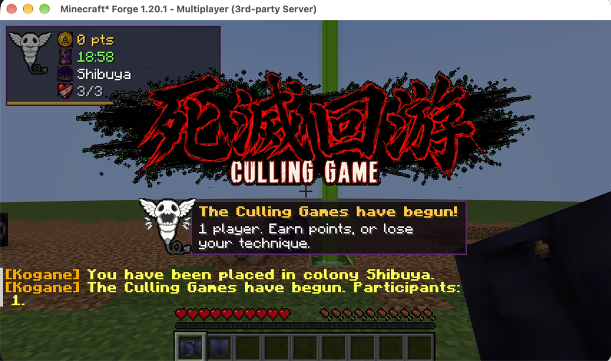
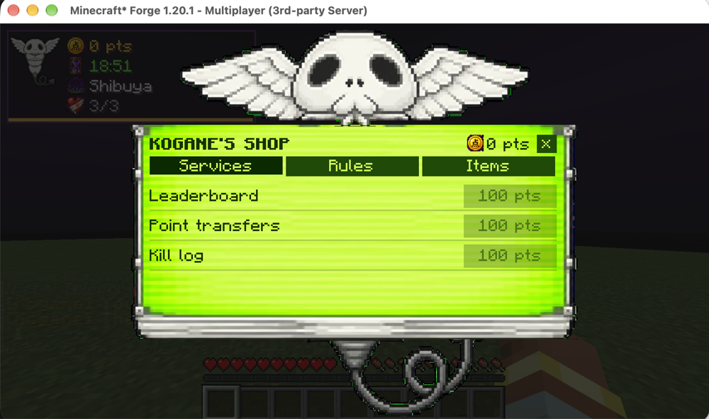

# Culling Games

A Forge 1.20.1 mod that runs a Culling Games event (inspired by *Jujutsu Kaisen*) on a Minecraft server. It is built for the Jujutsu Incident server and works alongside [Jujutsu Craft](https://www.curseforge.com/minecraft/mc-mods/jujutsucraft).

Status: pre-release, being tested before it goes live on the server.

## What it does
- **Event**: admins start, pause, resume and stop it, or schedule the end with a warning to spend points. It survives restarts.
- **Colonies**: circle or box areas. Players are spread across them at the start and can't leave (walking, ender pearls, chorus fruit and portals are blocked).
- **Points**: kills give points (players: 5 from Kogane plus 5 taken from the victim; hostile mobs: 1; all configurable). Shikigami kills count for their summoner; summons are never worth points. Every kill is logged.
- **Penalty**: if a player's points don't go up within the timer (default 19 minutes, warnings at 5 and 1), the admin-chosen penalty applies: their cursed technique is sealed (cursed energy drained) until they score again, or they lose an event life. At 0 lives they become a spectator. Everyone is restored when the event ends.
- **Kogane's shop**: admin-stocked items, a leaderboard, point transfers, kill-log access, rules that change the event (100 points each), and one-way cash-out to Lightman's Currency coins.
- **Client**: a HUD with your own points, timer, colony and lives, Kogane's shop screen (key **K**), on-screen announcements (title card at start and end, rule banner, Kogane warnings, barrier warning) and custom sounds. Players without the mod can still join and get chat and a bossbar instead. Clients with the mod must run the same version as the server.




## Requirements
- Minecraft 1.20.1, Forge 47.x, Java 17
- Optional: Jujutsu Craft (CT seal), Lightman's Currency (cash-out)

## Commands
`/cg help` lists everything. Players: `/cg points`, `/cg shop`, `/cg buy`, `/cg rules`, `/cg addrule`, `/cg transfer`, `/cg leaderboard`, `/cg killlog`, `/cg cashout`. Admins (op level 2): `/cg colony`, `/cg start`, `/cg pause`, `/cg resume`, `/cg stop [minutes]`, `/cg status`, `/cg participant`, `/cg points get|set|add|remove`, `/cg shop add|remove`, `/cg config`.

All values (timer, points, kill steal, lives, prices, coin item) are in `serverconfig/cullinggames-server.toml`, and admins can change them in game with `/cg config <key> <value>` (`/cg config` lists them).

## Building
```
./gradlew build
```
The jar is in `build/libs/`. Tests: `./scripts/gametest.sh` (runs Forge GameTests and checks they all passed).

Server admins: see [ADMIN_GUIDE.md](ADMIN_GUIDE.md). Development plan and status: [PLAN.md](PLAN.md).

## License
All rights reserved. The source is public to read; ask before reusing it.
